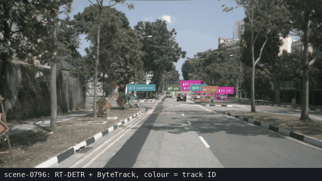
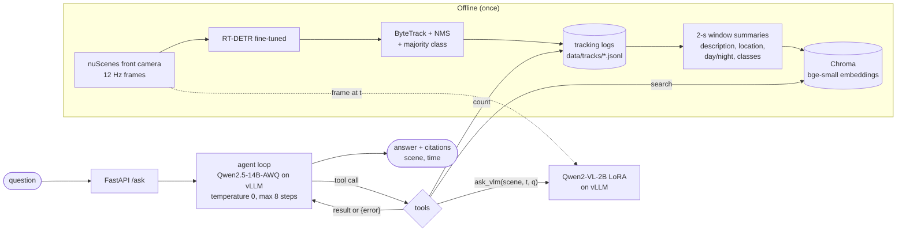

# scenesense

Urban scene understanding on Singapore driving video — a fine-tuned detector with tracking, a LoRA-tuned vision-language model for box-grounded scene QA, and an LLM agent that answers questions over the detection logs with frame citations.



*Tracking (RT-DETR + ByteTrack) on nuScenes scene-0796, then a recorded agent run from the eval set: `search` finds a 2-second window, `ask_vlm` checks a frame from it, and the answer cites scene and time. The last frame shows that frame with the tracker's bus box.*

Built on [nuImages](https://www.nuscenes.org/nuimages) and nuScenes (Singapore and Boston scenes; CC BY-NC-SA 4.0). Every headline number is reported with a bootstrap 95% confidence interval.

| Stage | Result |
|---|---|
| Detection (nuImages val) | RT-DETR fine-tuned **0.477 mAP** [0.470, 0.483], +0.304 over zero-shot |
| Speed (RTX 5090) | YOLO11s TensorRT fp16 **0.62 ms** / image (3.1× over PyTorch fp16, mAP change −0.0006 [−0.0015, +0.0005]); RT-DETR fp16 7.0 ms |
| Tracking (nuScenes mini) | 1,116 tracks, 33,665 events over 10 scenes |
| Grounded VQA (Qwen2-VL-2B) | LoRA **59.0% → 75.1%** (+16.1 [+13.9, +18.6]) |
| Serving (vLLM) | bf16 135 ms single-user, 18 req/s at concurrency 32; AWQ rejected (grounding drop) |
| Agent (51 held-out questions) | 14B-AWQ: 100% correct refusals, **86%** of answers cite a time the log supports |

## Setup

Requires Python 3.11+, [uv](https://docs.astral.sh/uv/), and an NVIDIA GPU (developed on an RTX 5090, CUDA 13).

```bash
git clone https://github.com/johncharles-dev/scenesense && cd scenesense
uv sync
```

## Data

[nuImages v1.0](https://www.nuscenes.org/nuimages) — 67,279 train / 16,445 val keyframes (1600×900) from Singapore (one-north, Queenstown) and Boston (seaport); train is 75% Singapore / 25% Boston. Licence CC BY-NC-SA 4.0; download requires registration and is not included here.

The 25 nuImages categories are merged to the 10 nuScenes detection classes (car, truck, bus, trailer, construction_vehicle, motorcycle, bicycle, pedestrian, traffic_cone, barrier); other categories are dropped. Each COCO image record carries `location`, `timestamp`, `local_hour` and `daypart` so results can be sliced by city and time of day.

Tracking and the agent use [nuScenes v1.0-mini](https://www.nuscenes.org/nuscenes) (10 scenes of ~20 s: Singapore one-north, Queenstown, Holland Village and Boston seaport; 3 at night) at `data/nuscenes`.

```bash
uv run python -m scenesense.data.nuimages_to_coco --version v1.0-train
uv run python -m scenesense.data.nuimages_to_coco --version v1.0-val
```

## Results — detection (nuImages val, 16,445 frames)

| Model | Params | Train (12 ep, 640 px, RTX 5090) | mAP@[.5:.95] | 95% CI |
|---|---|---|---|---|
| RT-DETR r50vd, COCO weights (zero-shot) | 42M | — | 0.173 | [0.171, 0.177] |
| YOLO11s, fine-tuned | 9.4M | 26 min | 0.404 | [0.400, 0.410] |
| **RT-DETR r50vd, fine-tuned** | 42M | 3 h 11 min | **0.477** | [0.470, 0.483] |

Paired bootstrap (200 resamples of val images): fine-tuning adds **+0.304** [0.297, 0.309] over zero-shot; RT-DETR beats YOLO11s by **+0.072** [0.069, 0.076] and leads on all 10 classes.

| | car | truck | bus | trailer | constr. | moto | bicycle | ped | cone | barrier | AP small | AP large |
|---|---|---|---|---|---|---|---|---|---|---|---|---|
| RT-DETR ft | 0.635 | 0.497 | 0.535 | 0.258 | 0.310 | 0.580 | 0.519 | 0.430 | 0.505 | 0.499 | 0.205 | 0.683 |
| YOLO11s ft | 0.574 | 0.437 | 0.437 | 0.179 | 0.250 | 0.504 | 0.448 | 0.348 | 0.434 | 0.434 | 0.134 | 0.623 |

Small objects are the main weakness (AP small 0.205 vs 0.683 large); higher input resolution is the next experiment. Models were trained with their standard recipes at equal epochs and resolution, so this is a recipe-level comparison.

### Slices

| Slice | Frames | RT-DETR ft | YOLO11s ft | Zero-shot | RT-DETR − YOLO (paired) |
|---|---|---|---|---|---|
| All val | 16,445 | 0.477 [0.470, 0.483] | 0.404 [0.400, 0.410] | 0.173 | +0.072 [0.069, 0.076] |
| Boston | 3,051 | 0.427 [0.417, 0.439] | 0.344 [0.333, 0.356] | 0.165 | +0.083 [0.076, 0.090] |
| Night (one drive) | 192 | 0.489 [0.418, 0.594] | 0.332 [0.254, 0.417] | 0.201 | +0.158 [0.097, 0.236] |

RT-DETR's lead holds in every slice and roughly doubles at night. The night slice is a single 192-frame drive, so its intervals understate the true uncertainty; treat it as indicative. Cross-slice differences for one model mix city and class-mix effects. Fine-tuned models drop 0.05–0.06 mAP in Boston while the zero-shot model drops only 0.008, suggesting fine-tuning specialised toward the majority city (train is 75% Singapore).

### Reproduce

```bash
uv run python -m scenesense.detect.train --out runs/rtdetr_r50_ft
uv run python -m scenesense.detect.predict --model runs/rtdetr_r50_ft/final --out data/preds/rtdetr_ft_val.json
uv run python -m scenesense.data.coco_to_yolo
uv run yolo detect train data=data/yolo/nuimages.yaml model=yolo11s.pt imgsz=640 epochs=12 batch=32 project=$PWD/runs name=yolo11s_ft
uv run yolo detect val data=data/yolo/nuimages.yaml model=runs/yolo11s_ft/weights/best.pt imgsz=640 conf=0.001 save_json=True project=$PWD/runs name=yolo11s_val
cp runs/yolo11s_val/predictions.json data/preds/yolo11s_ft_val.json
uv run python -m scenesense.eval.map_ci --gt data/coco/val.json \
    --pred data/preds/rtdetr_ft_val.json --pred data/preds/yolo11s_ft_val.json --n-boot 200
```

## Results — detector speed (RTX 5090, 640×640 input, model forward only)

Median of 200 timed iterations after 30 warm-up runs, measured with CUDA events. Pre- and post-processing (resize, NMS) are not included.

| Model | Runtime | Precision | Batch 1 median | Batch 16 throughput |
|---|---|---|---|---|
| RT-DETR r50vd | PyTorch | fp32 | 8.87 ms | 201 img/s |
| RT-DETR r50vd | PyTorch | fp16 | 7.01 ms | 381 img/s |
| YOLO11s | PyTorch | fp32 | 2.39 ms | 1,181 img/s |
| YOLO11s | PyTorch | fp16 | 1.94 ms | 2,092 img/s |
| **YOLO11s** | **TensorRT** | **fp16** | **0.62 ms** | **5,410 img/s** |

TensorRT fp16 makes YOLO11s 3.1× faster than PyTorch fp16 at batch 1 (2.6× at batch 16). Accuracy is unchanged within the CI: on the full val set the fp16 engine scores 0.404 [0.399, 0.409] mAP against 0.404 [0.400, 0.410] for PyTorch, a paired difference (TensorRT − PyTorch) of **−0.0006 [−0.0015, +0.0005]** (200 image-level bootstrap resamples, `reports/yolo11s_trt_vs_pytorch.json`). The comparison is end to end, so it also includes a preprocessing difference: the batch-1 engine sees a fixed 640×640 letterbox, while the PyTorch run used Ultralytics' default rectangular batches. This is the accuracy/speed trade-off: RT-DETR is +0.072 mAP better but ~11× slower than YOLO11s on TensorRT, so the offline pipeline here (tracking, logs) uses RT-DETR, and YOLO11s + TensorRT is the option for a real-time, on-vehicle budget.

```bash
uv run python scripts/bench_latency.py                                   # reports/latency_pytorch.json
uv run python scripts/bench_trt.py yolo11s=<engine> yolo11s_b16=<engine>  # reports/latency_trt.json
uv run yolo detect val data=data/yolo/nuimages.yaml model=runs/yolo11s_ft/weights/yolo11s_fp16_b1.engine imgsz=640 batch=1 \
    conf=0.001 half=True save_json=True plots=False project=$PWD/runs name=yolo11s_trt_b1_val
cp runs/yolo11s_trt_b1_val/predictions.json data/preds/yolo11s_trt_fp16_b1_val.json
uv run python -m scenesense.eval.map_ci --gt data/coco/val.json --pred data/preds/yolo11s_ft_val.json \
    --pred data/preds/yolo11s_trt_fp16_b1_val.json --n-boot 200 --out reports/yolo11s_trt_vs_pytorch.json
```

## Results — tracking (nuScenes mini, 10 scenes)

The fine-tuned RT-DETR runs on every front-camera frame (keyframes and sweeps, 12 Hz), then ByteTrack links detections into tracks. Two changes made the logs usable for counting:

- **Class-agnostic NMS (IoU 0.7) before tracking.** The detector sometimes puts two boxes with different classes (car and truck) on one object; without NMS each starts its own track and the object is counted twice.
- **One class per track (majority vote over its frames)** and **tracks shorter than 6 frames dropped** (0.5 s), which removes one-frame false positives and flicker.

Result: **1,116 tracks and 33,665 detection events** over the 10 scenes, written to `data/tracks/scene-*.jsonl` (one line per box: scene, location, frame, time, track ID, class, score, box). An ID-switch proxy is ~7%, so counts of distinct track IDs can be slightly inflated; the agent's `count` tool reports this with every result. Tracking was not scored against ground truth (no MOTA/HOTA), because nuScenes tracking labels are 3D boxes and would need projecting to the camera; the agent eval below checks the logs only indirectly.

```bash
uv run python -m scenesense.track.run_tracking --video scene-0796 scene-1100
```

## Results — grounded scene QA (Qwen2-VL-2B)

1,248 templated test questions from nuImages val images (answers from ground-truth boxes; 200 hand-checked, 185 kept as a verified subset).

| Type | Zero-shot | LoRA (r=16, 0.8% of weights) | Paired gain, 95% CI |
|---|---|---|---|
| Count (1–8, balanced) | 21.4% | 39.1% | +17.7 [+11.3, +25.0] |
| Exists (yes/no) | 82.8% | 91.6% | +8.8 [+4.8, +12.8] |
| Left / right | 78.8% | 95.2% | +16.4 [+11.6, +21.6] |
| Box grounding (IoU ≥ 0.5) | 55.8% | 74.6% | +18.8 |
| **All** | **59.0%** | **75.1%** | **+16.1 [+13.9, +18.6]** |
| Verified subset (185) | 70.8% | 84.9% | +14.1 |

A second epoch added nothing measurable (+0.6 [−0.9, +2.2]). The hand check found ~5% label noise in nuImages (reflections in shop windows labelled as vehicles), concentrated in single-object grounding questions.

## Results — serving the VLM (vLLM) and the AWQ decision

The LoRA adapter is merged into the base model and served with vLLM (OpenAI-compatible API) at the same pixel limits as training. Same 1,248 questions, full set:

| | bf16 (merged) | AWQ W4A16 |
|---|---|---|
| Model size on disk | 4.2 GB | 2.4 GB (−43%) |
| All questions | 74.4% [71.9, 76.5] | 73.1% [70.7, 75.4] |
| Box grounding | 74.0% [70.6, 77.8] | 70.0% [66.2, 73.8] |
| Single-user latency p50 (100 requests) | 135 ms | 114 ms |
| Throughput at concurrency 32 | 18.0 req/s | 18.1 req/s |

vLLM bf16 matches the Hugging Face evaluation within noise (74.4% vs 75.1%). AWQ cuts size by 43% and single-user latency by about 15% (p50 135 → 114 ms), but grounding drops 3.6–5.6 points with paired CIs that exclude 0, and throughput does not improve because image preprocessing on the CPU is the bottleneck at concurrency 32. **Decision: keep bf16.** The 2B model fits easily at bf16 (0.25 of the GPU), so the memory saving buys nothing here, and box grounding is the output the agent relies on.

```bash
uv run python scripts/merge_lora.py runs/qwen2vl2b_lora/adapter runs/qwen2vl2b_merged
uv run python -m scenesense.serve.eval_vllm --url http://localhost:8001/v1 --name vllm_bf16
uv run python -m scenesense.serve.eval_vllm --url http://localhost:8001/v1 --name vllm_bf16_c1 --concurrency 1 --limit 100
```

## Results — scene-query agent

An LLM agent answers questions about the 10 nuScenes-mini scenes with a hand-written tool-calling loop (OpenAI-compatible API on vLLM, no framework). Facts come from tools: `count` computes distinct track IDs from the tracking log (per scene, or per-scene breakdown + total + argmax over a location / day-night set); `search` retrieves 2-second windows from Chroma to find moments; `ask_vlm` sends a frame to the fine-tuned VLM using only its four trained question forms and ten classes. Every claim cites `(scene, time)`.



The split is deliberate: exact facts (counts, "which scene has the most X") come from a deterministic tool over the log, never from the LLM or from retrieved text. Retrieval is only for finding a moment, and the VLM only checks a single frame. Tool arguments are validated (scene, class, location, time inside the scene), and errors go back to the model as `{"error": ...}` so it can correct itself or say there is no data.

**Example trace** (eval question 27, Qwen2.5-14B-AWQ, recorded in `data/preds/agent_eval_qwen14b_awq.jsonl`):

```text
Q: Find a moment at a Boston intersection with a bus in view.
→ search(query="bus at intersection", location="boston-seaport")
    rank 1: scene-0757, 16-18 s, boston-seaport, day
            objects: bicycle, bus, car, motorcycle, pedestrian, traffic_cone, truck
            scene: "Arrive at busy intersection, bus, wait at intersection, bicycle, peds"
→ ask_vlm(scene="scene-0757", t=17.0, question="How many buses are in the image?")
    frame 202, t=17.0 s: "1"
A: In the moment you asked for, there is 1 bus in the image (scene-0757, 16-18 s).
   [2 tool calls, 1.42 s; the log has a bus in that window, so the citation is supported]
```

**Eval set.** 51 held-out questions, written before either model ran on them and excluding the 7 dev questions used while building the agent: count 10, total 5, compare 10, find-a-moment 8, VQA on a frame 8, grounding 1, unanswerable 9. Truth for counts, comparisons and moments is computed from the tracking logs by `scenesense.agent.build_eval`; VQA items use the tracker as reference at frames also checked by eye. Scoring is rule-based (unit-tested regexes) with a full hand audit. One run per model at temperature 0, same frozen prompt and tools; 95% bootstrap CIs over questions, paired for the difference.

| Metric | Qwen2.5-7B bf16 | Qwen2.5-14B-AWQ | Paired diff (14B − 7B) |
|---|---|---|---|
| Answer accuracy, answerable (n=42) | 97.6% [92.9, 100] | 92.9% [85.7, 100] | −4.8 [−11.9, 0.0] |
| Correct refusal, unanswerable (n=9) | 55.6% [22.2, 88.9] | 100%² | +44.4 [+11.1, +77.8] |
| Citation includes a time | 45.2% [31.0, 59.5] | 95.2% [88.1, 100] | +50.0 [+35.7, +64.3] |
| Citation supported by the log (class present/absent in that scene within ±1 s, as claimed), hand-audited | 40.5% [26.2, 54.8] (17/42) | 85.7% [73.8, 95.2] (36/42)¹ | +45.2 [+26.2, +64.3] |
| Tool calls that parse and run | 93.8% (61/65) | 95.2% (59/62) | — |
| Known upstream failures (n=2): names the described scene / claim supported by any tool | 2/2 / 0/2 | 2/2 / 0/2 | — |
| Latency p50 / mean | 0.68 s / 0.79 s | 0.64 s / 0.94 s | — |

¹ The automated rule-based check gives 37/42 (88.1% [78.6, 97.6]; paired diff +47.6 [+28.6, +64.3]). The hand audit disagreed once: a 14B answer names a scene where the log has no bicycle and then hedges "not consistently visible", which the rule read as supported. Both versions are in `reports/agent_eval_citation_audit.json`.

² 1 of 9 refusals also stated an ungrounded count (8 vs 9 in the log), with no tool call. The refusal itself was right, so it is scored correct, but it is not fully clean (see the failure analysis).

The 7B model is slightly better on answerable questions, but the difference is not significant (n=42; the CI's upper bound is exactly 0; it is two find-a-moment questions where the 14B checked the VLM, got "no" on a night frame and hedged). The 14B model is clearly better on refusals and on citations that the log actually supports. **We use Qwen2.5-14B-Instruct-AWQ**: for an agent, a confident wrong answer costs more than a refusal. The 7B answered "How many cars are in the Paris scenes?" with Queenstown's count (85) and turned "dogs" (not a tracked class) into "there are no dogs"; the 14B refused all 9 unanswerable questions. Both fit the same 0.60 GPU-memory budget. All failed tool calls were intended validation rejections (unknown class or scene, time outside the scene); none were malformed. Answerable questions are mostly easy *by design*: one `count` call returns the breakdown and argmax, so the discriminating part is refusal and citation discipline.

**Moved out of the main set: known upstream failures.** Two questions were moved out of the main set because the detector/tracker never found the object, so no tool can confirm it: "parked bicycles" in scene-0916 and a "construction vehicle" in scene-1077 appear in the scene descriptions but have zero tracks. They are reported in their own row rather than dropped, because dropping hard cases would make the main set look easier than it is.

**Failure analysis.**
- *Right scene from the description alone (both models, upstream set):* both models named the right scene in 2/2, but only because the scene description (returned by `search`) mentions the object. No tool found it: the tracker has zero tracks, and the 14B's only "evidence" for the construction vehicle was a VLM count of 1 on a frame where none is visible (checked by eye). That is a lucky guess, not detection.
- *An error passed on from one stage to the next:* in scene-1100 at 8 s the VLM answers "yes" to "Is there a truck in the image?". The tracker has no truck anywhere in that scene, and none is visible in the frame (checked by eye). Both agents faithfully report "there is a truck" with a correct-looking citation. The agent did its job and the claim is still false: an agent is only as reliable as its weakest tool, and nothing in the loop cross-checks the VLM against the tracker.
- *Ungrounded number inside a correct refusal (14B):* for "How many pedestrians crossed the street in scene-1100?" the 14B correctly says crossing is not measurable and labels the proxy, but then states "8 pedestrians tracked" without calling any tool (the log has 9). The refusal scorer counts it as correct; it breaks the "no number without a tool result" rule.
- Place substitution (7B): unknown places ("Paris") answered with a real location's data.
- Unknown class turned into zero (7B): "Unknown object class 'dog'" became "there are no dogs".
- Behaviour stated as fact (7B): "9 pedestrians crossed" with no proxy label.
- Tracker vs VLM disagreement on moments (both): the tracker has a motorcycle in a window, the VLM says "no" on the sampled frames (small or distant objects, night).
- Retrieval: the window text embeds the per-scene description plus the classes present, so retrieval works at scene level and only refines by class within a scene.

```bash
uv run python -m scenesense.agent.index                 # Chroma window index
uv run python -m scenesense.agent.build_eval            # 51 questions + 2 upstream-failure questions
uv run python -m scenesense.agent.loop "Which of the Boston scenes has the fewest buses?"
uv run python -m scenesense.agent.eval_agent run --name qwen14b_awq
uv run python -m scenesense.agent.eval_agent run --name upstream_qwen14b_awq --questions data/agent_eval/upstream.jsonl
uv run python -m scenesense.agent.eval_agent compare qwen7b qwen14b_awq
uv run python scripts/make_demo_gif.py                  # assets/demo.gif from the saved video and trace
```

## Serving — API and docker-compose

Two vLLM servers (VLM on :8001, agent LLM on :8002) and a CPU-only FastAPI app on :8080:

| Endpoint | What it does |
|---|---|
| `GET /health` | API up, both model servers reachable, tracking logs present (`degraded` instead of an error if one is down) |
| `POST /ask` | the agent; `{"question": ..., "include_trace": true}` returns the tool trace too |
| `POST /vqa` | multipart image + question → VLM (trained question forms only; others get 422 with the allowed forms) |
| `GET /count` | exact count from the tracking log, no model (`?object_class=bus&location=boston-seaport`) |

```bash
vllm serve runs/qwen2vl2b_merged --served-model-name scenesense-vlm --max-model-len 4096 \
    --limit-mm-per-prompt '{"image": 1}' --mm-processor-kwargs '{"min_pixels": 200704, "max_pixels": 802816}' \
    --gpu-memory-utilization 0.25 --port 8001
vllm serve Qwen/Qwen2.5-14B-Instruct-AWQ --served-model-name agent-llm --max-model-len 8192 \
    --gpu-memory-utilization 0.60 --enable-auto-tool-choice --tool-call-parser hermes --port 8002
uv run uvicorn scenesense.serve.api:app --host 0.0.0.0 --port 8080
```

Start the LLM only after the VLM is up: vLLM checks at startup that *free* GPU memory covers its share, so starting both at once can fail. `docker-compose.yml` encodes this order with healthchecks (`vlm` → `llm` → `api`). **The compose file is validated (`docker compose config`, image tags checked) but has not been run end-to-end yet**; the endpoints above were tested against the servers started by hand.
